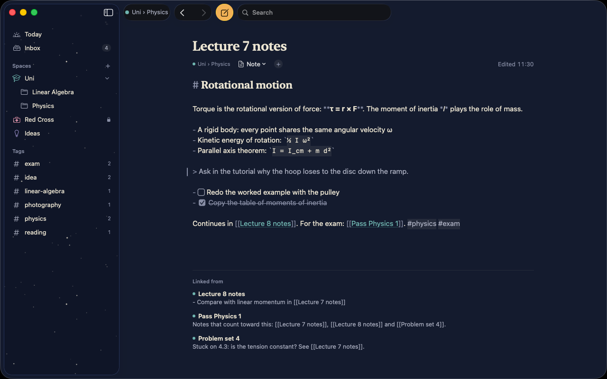
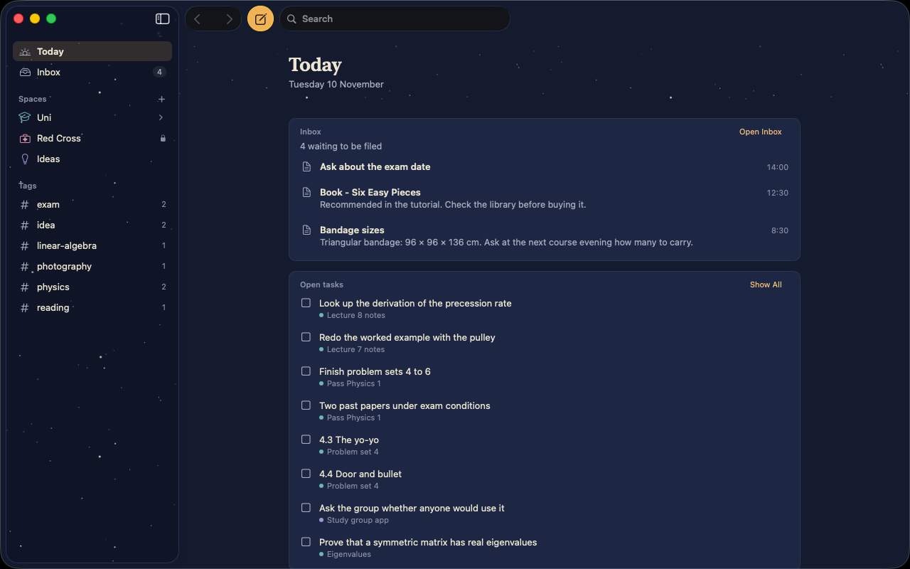
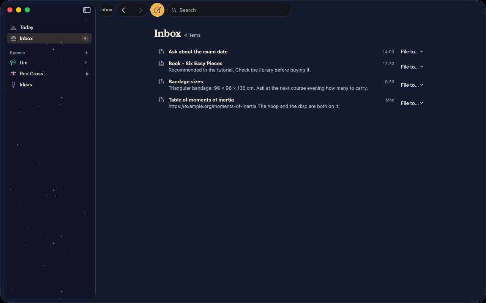
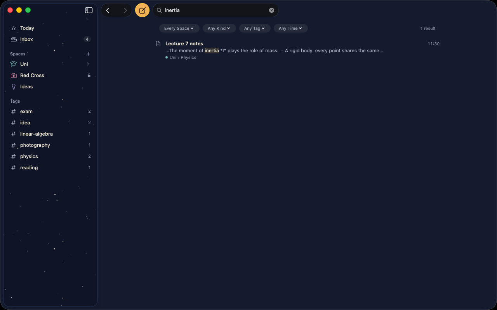
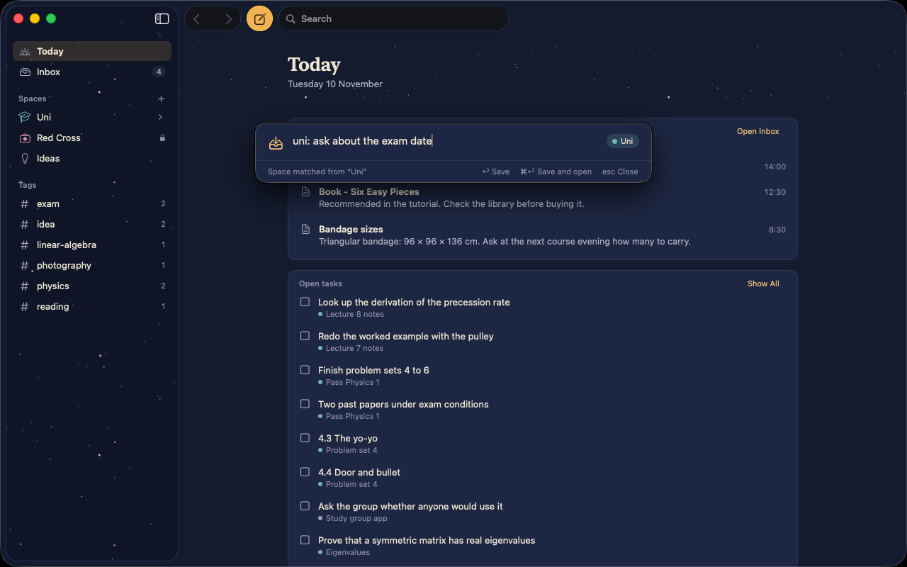
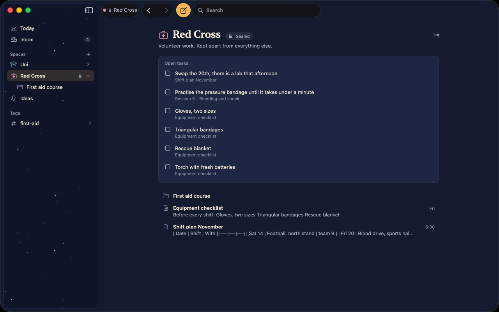
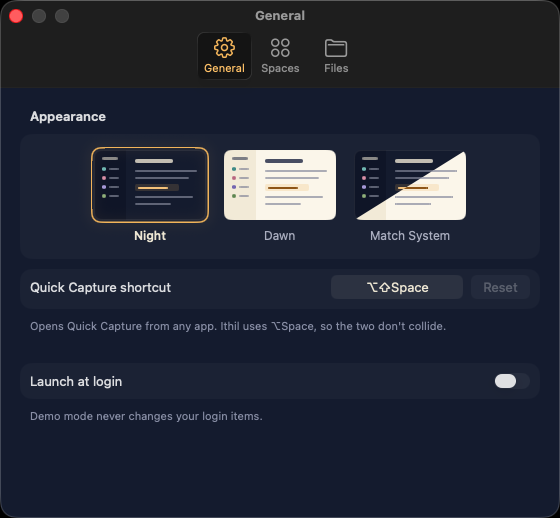
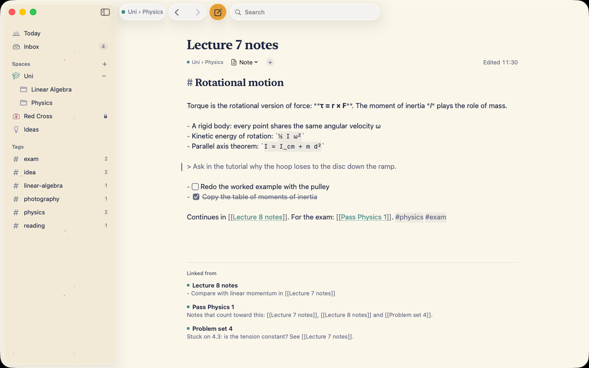

<p align="center">
  
</p>

<h1 align="center">Elenath</h1>

<p align="center">
  <strong>One private, offline home for your notes on the Mac: plain Markdown files in real Finder folders,
  with a small on-device assistant that files what you dump on it and shows how things connect.</strong>
</p>

<p align="center">
  <a href="https://github.com/Visaug36/Elenath/releases">Download</a> ·
  <a href="#how-your-files-are-stored">How files are stored</a> ·
  <a href="#privacy">Privacy</a> ·
  <a href="#faq">FAQ</a>
</p>

<p align="center">
  
</p>

Elenath is the sibling of [Ithil](https://github.com/Visaug36/Ithil), a calendar for students: the same look and
the same principles. Every note is a star, and links are the lines between them.

## Status

Elenath is being built in the open, one phase at a time. **Version 0.1 is for notes**: everything below under
"What it does" works. Nano bot, the assistant, arrives in 0.2.

| Version | What it adds |
|---|---|
| 0.0.1 | The themed window, Settings with the appearance choice, the folder format |
| 0.1 | The library, spaces and sealing, the editor, Inbox and Quick Capture, links, tags, tasks, keyword search, import, Today |
| 0.2 | Search by meaning, text in PDFs and pictures, and Nano bot: filing the Inbox, links, tidying, summaries, answers from your notes |
| later | The bridge to Ithil, boards and charts, goals and the Sky |

## What it does

- **Spaces.** A space is a folder for one part of your life: university, volunteering, ideas. Spaces connect by
  default, so a link or a search can reach from an idea to a course. A space can be **sealed**: then its notes
  stay out of search, links and Today everywhere else, and nothing from other spaces shows up inside it.
- **An editor that stays out of the way.** One pane of Markdown, styled as you type: headings, lists, quotes,
  code, tables, links between notes (`[[Title]]`, with completion as you type `[[`), `#tags`, and tasks you can
  tick. Pictures and PDFs you drop on a note are copied next to it and shown in it. The notes that link to this
  one are listed under it. Any language, right to left included.
- **Inbox and Quick Capture.** Press <kbd>⌥</kbd><kbd>⇧</kbd><kbd>Space</kbd> in any app, type or paste, and
  it's in the Inbox. Start with a space's name ("uni: …") and it goes straight there. File Inbox items to a
  space or folder from the Inbox or the note itself.
- **Today**: what waits in the Inbox, open tasks and the notes you edited lately.
- **Search** across titles, text, tags and file names as you type, with filters for space, folder, tag and kind.
  <kbd>⌘</kbd><kbd>O</kbd> jumps to a note by its title.
- **Import**: drop Markdown, text, Word and rich-text documents, PDFs, pictures, whole folders or a WhatsApp chat
  on a space or the Inbox. Everything is copied; your originals stay where they were.
- **Plain files, live.** Rename or move a note and the links to it follow. Edit a note in another app and Elenath
  shows the change at once. If a note changes on disk while you have unsaved edits, you keep both.
- **Undo for everything**: typing, ticking a task, renaming, moving, filing, trashing.
- **Night and Dawn**, or matching the system.

<p align="center">
  
  
</p>
<p align="center">
  
  
</p>
<p align="center">
  
  
</p>
<p align="center">
  
</p>

### Coming later

- **Nano bot** (0.2), a small assistant that runs on the Mac: it proposes where an Inbox item belongs, which
  notes to link, a tidier version of a messy dump, and answers questions from your notes. It never changes
  anything by itself.
- **The bridge to Ithil**: what's up next, and notes for each lecture.
- **Boards, charts, goals and the Sky**, a map of your notes as stars.

## Download

1. Download **Elenath-x.y.z.zip** from the [releases page](https://github.com/Visaug36/Elenath/releases), the
   first file under **Assets**. (Not "Source code": that's the project's code, which you only need to build
   Elenath yourself.)
2. Double-click the zip to unzip it, and drag **Elenath** to your **Applications** folder.
3. Open it. Elenath isn't notarized by Apple (that needs a paid developer account), so the first time macOS says
   it can't verify the developer:
   - Open **System Settings → Privacy & Security**.
   - Scroll to the message about Elenath and click **Open Anyway**, then confirm.

   You only need to do this once per version. To check the download, compare its SHA-256 with the `.sha256` file
   on the release page: `shasum -a 256 Elenath-x.y.z.zip`.
4. On first launch Elenath asks for a folder for your notes. It suggests `Documents/Elenath`; any folder you
   choose works, also one that already holds Markdown files. Then it suggests a few spaces to start with (Uni,
   Red Cross, which is sealed, Ideas and Personal). Change them there or later in Settings.

Requires macOS 26 or later on a Mac with Apple silicon.

To bring in the notes you have elsewhere, see [docs/IMPORT.md](docs/IMPORT.md).

### Keyboard

| Keys | What they do |
|---|---|
| <kbd>⌥</kbd><kbd>⇧</kbd><kbd>Space</kbd> | Quick Capture, from any app (change it in Settings) |
| <kbd>⌘</kbd><kbd>N</kbd> / <kbd>⇧</kbd><kbd>⌘</kbd><kbd>N</kbd> | New note / new folder |
| <kbd>⌘</kbd><kbd>O</kbd> | Jump to a note by its title |
| <kbd>⌘</kbd><kbd>F</kbd> / <kbd>⇧</kbd><kbd>⌘</kbd><kbd>F</kbd> | Find in the note / search everywhere |
| <kbd>⌘</kbd><kbd>1</kbd> / <kbd>⌘</kbd><kbd>2</kbd> | Today / the Inbox |
| <kbd>⌘</kbd><kbd>[</kbd> / <kbd>⌘</kbd><kbd>]</kbd> | Back / forward |
| <kbd>⌘</kbd>-click or <kbd>⌘</kbd><kbd>↩</kbd> on a link | Follow it |
| <kbd>⇧</kbd><kbd>⌘</kbd><kbd>I</kbd> | Import files or folders |
| <kbd>⌘</kbd><kbd>Z</kbd> / <kbd>⇧</kbd><kbd>⌘</kbd><kbd>Z</kbd> | Undo / redo, for edits and for changes to notes and folders |

## How your files are stored

Everything lives in one folder you choose. It's plain files, so copying the folder is a full backup:

```
Elenath/
├── .elenath/
│   ├── library.json                  the library's id, the order of your spaces
│   └── backups/                      earlier versions of the settings files
├── Inbox/                            everything you dump, until it's filed
├── Uni/                              a space
│   ├── .space/
│   │   ├── space.json                its color, symbol, keywords, and whether it's sealed
│   │   └── backups/
│   └── Physics/
│       ├── Lecture 7 notes.md        a note: Markdown that any editor can open
│       └── Attachments/              files dropped on notes in this folder
└── Red Cross/                        another space
```

- Notes are UTF-8 Markdown. A note's title is its file name. Elenath never reformats a note, and keeps
  anything in it that it doesn't understand. Notes it makes start with a few lines of front matter (an `id`
  and the date), which lets it repair links when you rename a note in Finder.
- You can work in Finder too: new folders, renames and edits in other apps show up in Elenath at once. A new
  folder at the top of the library becomes a space.
- Files you drop are **copied**; the originals stay where they were.
- Deleting moves to the **Trash**. Elenath never deletes anything permanently.
- The full contract is in [docs/FORMAT.md](docs/FORMAT.md), so another app could read the same folder.

## Nano bot (from version 0.2)

Nano bot will use the language model that Apple builds into macOS, on the Mac itself. Version 0.1 has no
assistant: you file the Inbox by hand.

- **What it needs:** a Mac with Apple silicon, macOS 26 or later, and Apple Intelligence turned on. If any of
  that is missing, everything else in Elenath works as usual.
- **What it can't do:** go online, see anything outside your library, read a sealed space from outside it, or
  change a note without you accepting the change. It is a small model: it files and suggests, it doesn't know
  facts about the world.

## Privacy

- **No network.** Elenath runs in the App Sandbox without the network entitlement, so macOS itself stops it
  from going online. "Check for Updates…" and "Report an Issue…" just open GitHub in your browser.
- **No accounts, no analytics, no tracking**, and no third-party code.
- **Everything stays in your folder**, plus a search index and safety copies in Elenath's own container in
  `~/Library/Containers/io.github.visaug36.Elenath/`.
- **Sealed spaces stay sealed.** Elenath checks it with tests that plant a word in a sealed space and make sure
  it never shows up in another space's search, links, tags, tasks or Today.

## Backup and moving to a new Mac

- **Backup:** copy your Elenath folder, or let Time Machine do it. It's a complete backup.
- **New Mac:** copy the folder over, install Elenath, and choose the folder on first launch. The search index
  rebuilds itself.

## Uninstall

1. Quit Elenath.
2. Drag `/Applications/Elenath.app` to the Trash.
3. Optional: delete `~/Library/Containers/io.github.visaug36.Elenath` (settings, the index and safety copies).

Your Elenath folder with your notes stays where it is until you delete it yourself.

## FAQ

**macOS says it can't verify Elenath.**
That's the step under [Download](#download): System Settings → Privacy & Security → Open Anyway.

**Does it run on an Intel Mac, or on macOS 15?**
No. Elenath needs Apple silicon and macOS 26.

**Something went wrong with a note. Where are my words?**
Elenath saves as you type, and a save never half-writes a file. If a note changed on disk while you were
editing it, your version is kept as "Title (conflict date time)" next to it. If a save fails, the window says
so and keeps your text; a copy also goes to `Recovery` in Elenath's container
(`~/Library/Containers/io.github.visaug36.Elenath/Data/Library/Application Support/Elenath/Recovery`).

**Where did a deleted note go?**
To the Trash, like a file deleted in Finder. <kbd>⌘</kbd><kbd>Z</kbd> brings it back, or put it back from the
Trash.

**Does Elenath sync between Macs?**
Not by itself. It's a folder of plain files, so a folder sync you already trust works. Use it on one Mac at a
time.

**Can I use my notes in another app?**
Yes. They're Markdown files. Links, tags and tasks follow the same conventions as Obsidian where they overlap,
so you can even open the same folder in Obsidian.

## Build from source

You need Xcode 26 on macOS 26. There are no dependencies.

```sh
git clone https://github.com/Visaug36/Elenath.git
cd Elenath
open Elenath.xcodeproj        # then ⌘R to run, ⌘U to test
scripts/install.sh            # or build Release and install it in /Applications
```

The logic lives in `ElenathCore` with Swift Testing tests. See [docs/ARCHITECTURE.md](docs/ARCHITECTURE.md),
[docs/DESIGN.md](docs/DESIGN.md) and [docs/FORMAT.md](docs/FORMAT.md).

## Contributing

Elenath is a personal project, built for one person's notes. Issues are welcome; please read
[CONTRIBUTING.md](CONTRIBUTING.md) and the [Code of Conduct](CODE_OF_CONDUCT.md) first. Security problems go
through [private vulnerability reporting](SECURITY.md).

## License

[MIT](LICENSE) © 2026 Visaug36.

"Elenath" is a Sindarin word from J.R.R. Tolkien's writings, meaning all the stars together. This project isn't
affiliated with or endorsed by the Tolkien Estate.
