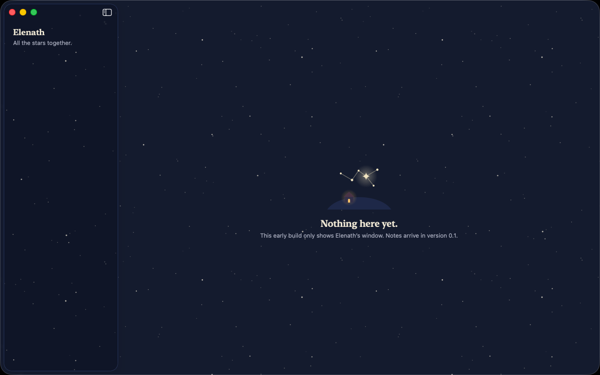
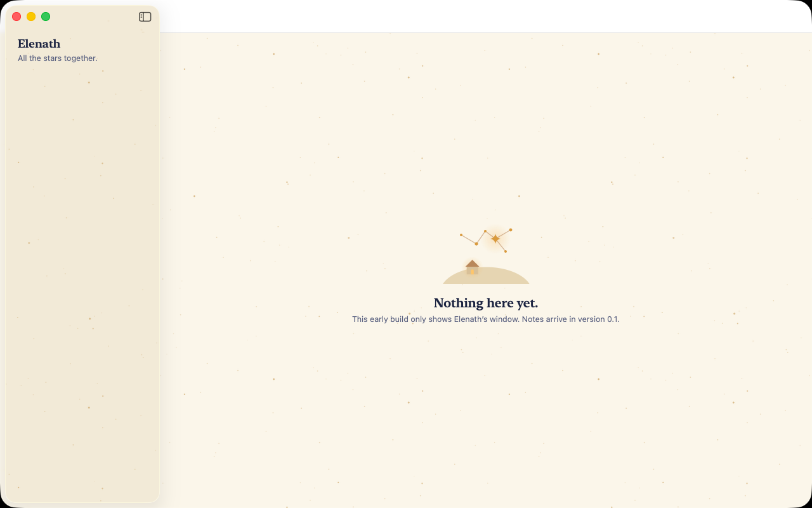

<h1 align="center">Elenath</h1>

<p align="center">
  <strong>One private, offline home for your notes on the Mac: plain Markdown files in real Finder folders,
  with a small on-device assistant that files what you dump on it and shows how things connect.</strong>
</p>

<p align="center">
  <a href="https://github.com/Visaug36/Elenath/releases">Download</a> ·
  <a href="#how-your-files-are-stored">How files are stored</a> ·
  <a href="#privacy">Privacy</a> ·
  <a href="#faq">FAQ</a>
</p>

<p align="center">
  
</p>

Elenath is the sibling of [Ithil](https://github.com/Visaug36/Ithil), a calendar for students: the same look and
the same principles. Every note is a star, and links are the lines between them.

## Status

Elenath is being built in the open, one phase at a time. **Version 0.0.1 is only the window**: the look, the
Night and Dawn appearances and the project's foundations. Notes arrive in 0.1.

| Version | What it adds |
|---|---|
| 0.0.1 | The themed window, Settings with the appearance choice, the folder format and the plans below |
| 0.1 | The library, spaces and sealing, the editor, Inbox and Quick Capture, links, tags, tasks, keyword search, import, Today |
| later | Search by meaning, Nano bot, the bridge to Ithil, boards and charts, goals and the Sky |

## What it will do

- **Spaces.** A space is a folder for one part of your life: university, volunteering, ideas. Spaces connect by
  default, so you can see how an idea touches a course or a goal. A space can be **sealed**: then its notes stay
  out of search, links and suggestions everywhere else, and nothing from other spaces shows up inside it.
- **An editor that stays out of the way.** One pane of Markdown, styled as you type, with links between notes
  (`[[Title]]`), tags, tasks you can tick, and the notes that link back shown under each note.
- **Inbox and Quick Capture.** Press <kbd>⌥</kbd><kbd>⇧</kbd><kbd>Space</kbd> in any app, type or paste, and
  it's in the Inbox. Start with a space's name ("uni: …") and it goes straight there.
- **Search** across titles, text and tags, and later by meaning.
- **Nano bot**, a small assistant that runs on the Mac: it proposes where an Inbox item belongs, which notes to
  link, and a tidier version of a messy dump. It never changes anything by itself.
- **Boards, charts, goals and the Sky**, a map of your notes as stars.

<p align="center">
  
</p>

## Download

1. Download **Elenath-x.y.z.zip** from the [releases page](https://github.com/Visaug36/Elenath/releases), the
   first file under **Assets**. (Not "Source code": that's the project's code, which you only need to build
   Elenath yourself.)
2. Double-click the zip to unzip it, and drag **Elenath** to your **Applications** folder.
3. Open it. Elenath isn't notarized by Apple (that needs a paid developer account), so the first time macOS says
   it can't verify the developer:
   - Open **System Settings → Privacy & Security**.
   - Scroll to the message about Elenath and click **Open Anyway**, then confirm.

   You only need to do this once per version. To check the download, compare its SHA-256 with the `.sha256` file
   on the release page: `shasum -a 256 Elenath-x.y.z.zip`.

Requires macOS 26 or later on a Mac with Apple silicon.

## How your files are stored

Everything lives in one folder you choose. It's plain files, so copying the folder is a full backup:

```
Elenath/
├── .elenath/
│   ├── library.json                  the library's id, the order of your spaces
│   └── backups/
├── Inbox/                            everything you dump, until it's filed
├── Uni/                              a space
│   ├── .space/
│   │   └── space.json                its color, symbol, and whether it's sealed
│   └── Physics/
│       ├── Lecture 7 notes.md        a note: Markdown that any editor can open
│       └── Attachments/              files dropped on notes in this folder
└── Red Cross/                        another space
```

- Notes are UTF-8 Markdown. Elenath never reformats a note, and keeps anything in it that it doesn't understand.
- Files you drop are **copied**; the originals stay where they were.
- Deleting moves to the **Trash**. Elenath never deletes anything permanently.
- The full contract is in [docs/FORMAT.md](docs/FORMAT.md), so another app could read the same folder.

## Nano bot

Nano bot will use the language model that Apple builds into macOS, on the Mac itself.

- **What it needs:** a Mac with Apple silicon, macOS 26 or later, and Apple Intelligence turned on. If any of
  that is missing, everything else in Elenath works as usual.
- **What it can't do:** go online, see anything outside your library, read a sealed space from outside it, or
  change a note without you accepting the change. It is a small model: it files and suggests, it doesn't know
  facts about the world.

## Privacy

- **No network.** Elenath runs in the App Sandbox without the network entitlement, so macOS itself stops it
  from going online. "Check for Updates…" and "Report an Issue…" just open GitHub in your browser.
- **No accounts, no analytics, no tracking**, and no third-party code.
- **Everything stays in your folder**, plus a search index and safety copies in Elenath's own container in
  `~/Library/Containers/io.github.visaug36.Elenath/`.

## Backup and moving to a new Mac

- **Backup:** copy your Elenath folder, or let Time Machine do it. It's a complete backup.
- **New Mac:** copy the folder over, install Elenath, and choose the folder on first launch. The search index
  rebuilds itself.

## Uninstall

1. Quit Elenath.
2. Drag `/Applications/Elenath.app` to the Trash.
3. Optional: delete `~/Library/Containers/io.github.visaug36.Elenath` (settings, the index and safety copies).

Your Elenath folder with your notes stays where it is until you delete it yourself.

## FAQ

**macOS says it can't verify Elenath.**
That's the step under [Download](#download): System Settings → Privacy & Security → Open Anyway.

**Does it run on an Intel Mac, or on macOS 15?**
No. Elenath needs Apple silicon and macOS 26.

**Does Elenath sync between Macs?**
Not by itself. It's a folder of plain files, so a folder sync you already trust works. Use it on one Mac at a
time.

**Can I use my notes in another app?**
Yes. They're Markdown files. Links, tags and tasks follow the same conventions as Obsidian where they overlap.

## Build from source

You need Xcode 26 on macOS 26. There are no dependencies.

```sh
git clone https://github.com/Visaug36/Elenath.git
cd Elenath
open Elenath.xcodeproj        # then ⌘R to run, ⌘U to test
scripts/install.sh            # or build Release and install it in /Applications
```

The logic lives in `ElenathCore` with Swift Testing tests. See [docs/ARCHITECTURE.md](docs/ARCHITECTURE.md),
[docs/DESIGN.md](docs/DESIGN.md) and [docs/FORMAT.md](docs/FORMAT.md).

## Contributing

Elenath is a personal project, built for one person's notes. Issues are welcome; please read
[CONTRIBUTING.md](CONTRIBUTING.md) and the [Code of Conduct](CODE_OF_CONDUCT.md) first. Security problems go
through [private vulnerability reporting](SECURITY.md).

## License

[MIT](LICENSE) © 2026 Visaug36.

"Elenath" is a Sindarin word from J.R.R. Tolkien's writings, meaning all the stars together. This project isn't
affiliated with or endorsed by the Tolkien Estate.
